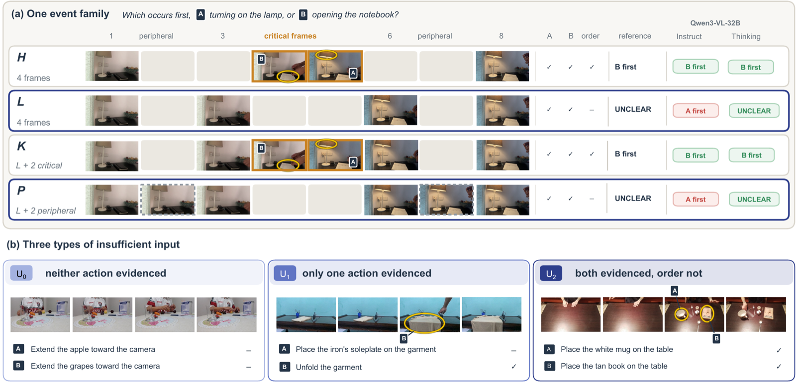
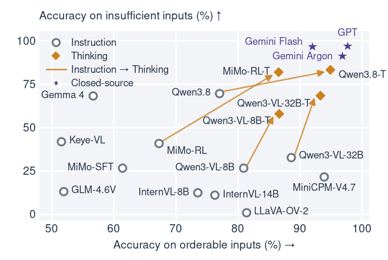

<div align="center">

# EvOrderBench

### When Do Sampled Frames Establish Event Order?

Xiaoqin Feng<sup>1*</sup>, Yuqi Li<sup>2*</sup>, Xinyuan Li<sup>1</sup>, Neil Rodrigues<sup>3</sup>, Xianglong Wang<sup>3</sup>, Kuiye Ding<sup>4</sup>, Yingli Tian<sup>2†</sup>

<sup>1</sup>University of Southern California &nbsp; <sup>2</sup>City University of New York &nbsp; <sup>3</sup>Wyze Inc. &nbsp; <sup>4</sup>University of Technology Sydney<br>
<sub>* Equal contribution &nbsp; † Corresponding author</sub>

[](https://xqfeng-josie.github.io/EvOrderBench/)
[](https://huggingface.co/datasets/xiaoqinfeng/EvOrderBench)
[](LICENSE)
[](https://huggingface.co/datasets/xiaoqinfeng/EvOrderBench)

</div>

<p align="center">
  
</p>

EvOrderBench tests whether a vision-language model states the order of two actions **only when the frames it
receives establish that order**. Each of its **579 event families** fixes one episode and one question and varies
only the frames: some inputs establish the order, others miss an action (`U0`, `U1`) or show both actions but not
their order (`U2`), and the correct answer for those is `UNCLEAR`.

| | |
|---|---|
| **Event families** | 579, from Perception Test, HO-Cap, and CaptainCook4D |
| **Inputs** | 2,316: 1,189 orderable, 1,127 insufficient (277 `U0` · 240 `U1` · 610 `U2`) |
| **Queries** | 4,632, each input under both assignments of the answer letters |
| **Answers** | `A`, `B`, or `UNCLEAR` |

## Results

Accuracy (%) on all 4,632 queries. 95% cluster-bootstrap intervals are in
[`code/expected_results.txt`](code/expected_results.txt).

| Model | Overall | Ord. | Insuf. | U0 | U1 | U2 | Pair<sub>HL</sub> | Pair<sub>KP</sub> | Family |
|---|---:|---:|---:|---:|---:|---:|---:|---:|---:|
| *Closed-source references* | | | | | | | | | |
| GPT-6.1 Sol | **97.3** | **97.7** | **96.9** | 99.5 | **96.2** | **96.1** | **94.6** | **95.7** | **90.5** |
| Gemini 3.8 Flash | 94.4 | 92.0 | **96.9** | **99.8** | 96.0 | 95.9 | 88.8 | 90.3 | 81.3 |
| Gemini 4 Argon | 94.1 | 96.8 | 91.3 | 98.2 | 91.5 | 88.1 | 87.8 | 90.1 | 83.2 |
| *Open, thinking* | | | | | | | | | |
| Qwen3.8-27B (Thinking) | **89.3** | **95.0** | **83.3** | **91.5** | **81.7** | 80.2 | **80.1** | **80.4** | **67.5** |
| MiMo-VL-7B-RL (Thinking) | 84.2 | 86.6 | 81.7 | 89.7 | 73.1 | **81.4** | 69.9 | 72.0 | 51.5 |
| Qwen3-VL-32B-Thinking | 81.2 | 93.3 | 68.4 | 79.6 | 52.1 | 69.8 | 65.1 | 63.7 | 48.4 |
| Qwen3-VL-8B-Thinking | 72.6 | 86.7 | 57.8 | 68.4 | 49.8 | 56.1 | 51.3 | 50.3 | 32.1 |
| *Open, instruction* | | | | | | | | | |
| Qwen3.8-27B | **73.4** | 77.0 | **69.5** | **91.0** | 50.8 | **67.1** | **52.2** | **52.6** | **33.0** |
| Gemma 4 12B | 62.3 | 56.6 | 68.3 | 86.8 | **64.8** | 61.2 | 33.5 | 36.3 | 20.0 |
| Qwen3-VL-32B | 61.5 | 88.6 | 32.9 | 74.4 | 6.5 | 24.4 | 29.0 | 30.7 | 23.1 |
| MiniCPM-V4.7 | 58.7 | **93.9** | 21.6 | 50.0 | 1.5 | 16.6 | 21.3 | 21.5 | 19.3 |
| MiMo-VL-7B-RL | 54.5 | 67.3 | 40.9 | 73.8 | 42.9 | 25.2 | 28.1 | 27.0 | 10.7 |
| Qwen3-VL-8B | 54.4 | 80.9 | 26.6 | 66.6 | 22.7 | 9.9 | 23.7 | 21.1 | 16.8 |
| Keye-VL-1.5-8B | 46.8 | 51.6 | 41.9 | 58.8 | 27.5 | 39.8 | 16.8 | 15.9 | 5.0 |
| InternVL3.5-14B | 44.5 | 76.3 | 11.0 | 31.9 | 10.4 | 1.6 | 9.5 | 9.1 | 7.3 |
| MiMo-VL-7B-SFT | 44.5 | 61.4 | 26.6 | 60.1 | 30.0 | 10.1 | 19.1 | 15.8 | 5.9 |
| InternVL3.5-8B | 43.7 | 73.5 | 12.2 | 36.1 | 9.0 | 2.7 | 8.7 | 11.0 | 7.3 |
| LLaVA-OneVision-2-8B | 42.2 | 81.3 | 0.9 | 3.8 | 0.0 | 0.0 | 1.1 | 0.8 | 3.1 |
| GLM-4.6V-Flash | 33.1 | 51.9 | 13.2 | 48.2 | 5.6 | 0.2 | 8.0 | 6.7 | 0.3 |
| *Baselines* | | | | | | | | | |
| Always A | 25.7 | 50.0 | 0.0 | 0.0 | 0.0 | 0.0 | 0.0 | 0.0 | 0.0 |
| Always UNCLEAR | 48.7 | 0.0 | 100.0 | 100.0 | 100.0 | 100.0 | 0.0 | 0.0 | 1.2 |

**Ord.** and **Insuf.**: accuracy on orderable and insufficient inputs. **U0/U1/U2**: Insuf. on inputs in which
zero, one, or both actions are evidenced. **Pair<sub>HL</sub>**, **Pair<sub>KP</sub>**: the input that
establishes the order answered correctly *and* its insufficient counterpart answered `UNCLEAR`. **Family**: all
eight queries of a family correct. Bold marks the best value within each group.

<p align="center">
  
</p>

- **Ordering and withholding diverge.** When the frames establish the order, the best open models nearly match
  the closed references, yet only two open configurations withhold correctly on more than 70% of insufficient
  inputs, against at least 90% for every reference.
- **What is missing matters.** Open models withhold mainly when the frames show neither action. Once at least one
  action is shown, most commit to an order.
- **Thinking narrows the gap**, mainly by separating sufficient from insufficient evidence rather than by making
  models more cautious overall.

## Quick start

The scripts need Python 3.8 or later and no packages (`evaluate.py --ci` additionally needs numpy).

**1. Get the code and the data** (about 4 GB, mostly frames):

```bash
git clone https://github.com/XqFeng-Josie/EvOrderBench.git && cd EvOrderBench
pip install -U huggingface_hub
hf download xiaoqinfeng/EvOrderBench --repo-type dataset --local-dir datasets
```

**2. Reproduce the table above** from the released answers of all 19 configurations:

```bash
python code/evaluate.py          # point estimates
python code/evaluate.py --ci     # with 95% cluster-bootstrap intervals; matches code/expected_results.txt
```

**3. Evaluate your model** through any OpenAI-compatible endpoint, hosted or local (for example vLLM):

```bash
python code/run_openai_api.py --model MODEL --base-url http://localhost:8000/v1 --out outputs/MODEL
python code/evaluate.py --predictions outputs/MODEL/predictions.csv
```

See [`code/README.md`](code/README.md) for the options (including reasoning models), the answer-extraction rule,
and the metrics, and the [dataset card](https://huggingface.co/datasets/xiaoqinfeng/EvOrderBench) for the data
format and labels.

## Repository layout

```
code/
  evaluate.py                  scores predictions with the metrics of the table above
  run_openai_api.py            runs a model on all 4,632 queries through an OpenAI-compatible endpoint
  extract_answer.py            maps a model output to A, B, or UNCLEAR
  predictions/predictions.csv  answers of the 19 configurations evaluated in the paper
  expected_results.txt         output of evaluate.py --ci
datasets/                      the benchmark, downloaded from Hugging Face (not tracked here)
```

## License

The code is released under the [MIT License](LICENSE). The EvOrderBench annotations (questions, frame
selections, and labels) are released under CC BY 4.0; the frames keep the licenses of their source datasets
(Perception Test and HO-Cap: CC BY 4.0; CaptainCook4D: Apache 2.0). Please cite the source datasets together with
EvOrderBench when you use the frames.

## Citation

```bibtex
@misc{feng2026evorderbench,
  title  = {EvOrderBench: When Do Sampled Frames Establish Event Order?},
  author = {Xiaoqin Feng and Yuqi Li and Xinyuan Li and Neil Rodrigues and Xianglong Wang and Kuiye Ding and Yingli Tian},
  year   = {2026}
}
```
